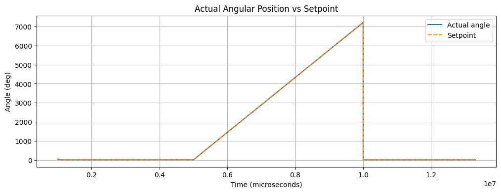
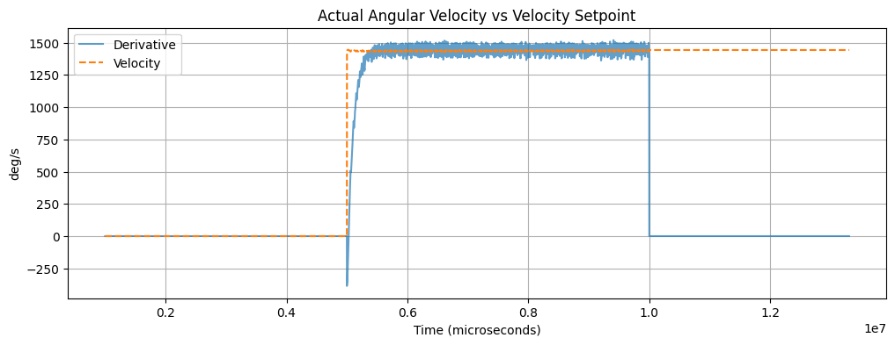
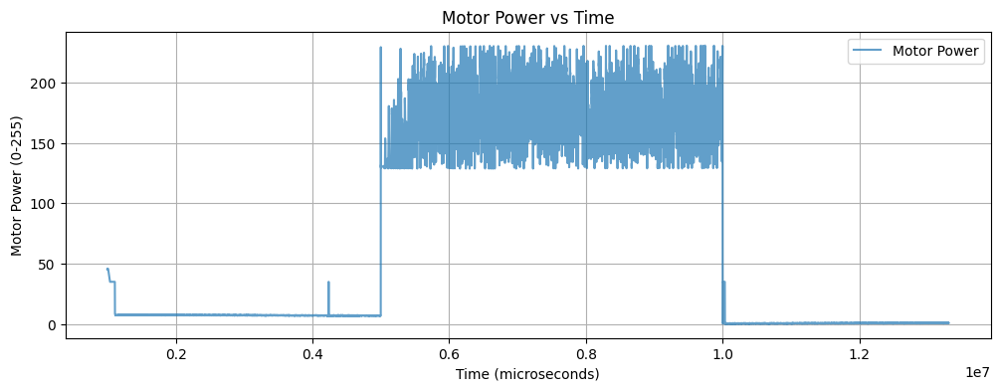
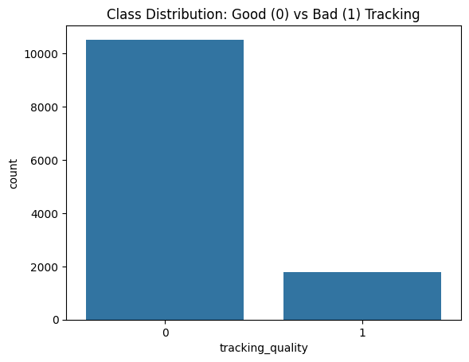
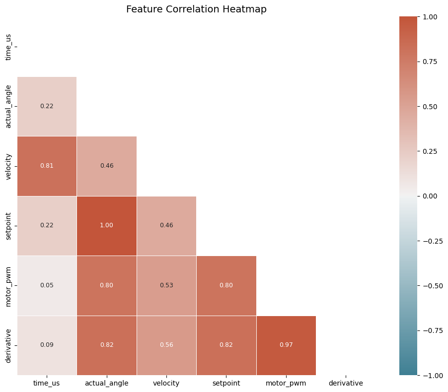
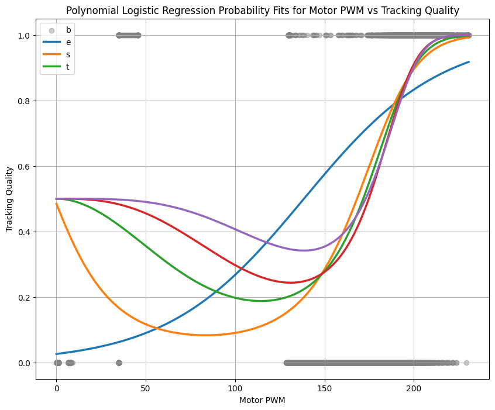
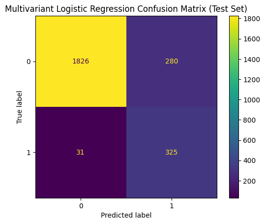

# Data-Driven Problem Solving: BIRD Dataset <kbd>2025</kbd>
`Data Analysis` `Experimental Validation` `Python` `Machine Learning` `Scikit-Learn` `Pandas` `NumPy` `Matplotlib`

*Analyzed experimental encoder data from the CU-BIRD flapping-wing micro air vehicle (FWMAV) to characterize motor tracking performance, identify sources of error, and evaluate machine-learning models for classifying tracking quality.*

  

---

## Experimental Overview

To evaluate motor performance beyond idealized step responses, I analyzed experimental data from the cascaded position–velocity PID controller under dynamic operating conditions. The dataset includes commanded and measured angular position, velocity, motor PWM, and timing information.

As part of my earlier CU-BIRD research, I developed the digital PID control code and upgraded the feedback hardware from 12-count relative encoders to 14-bit absolute encoders. This analysis extends that work by examining tracking performance and identifying conditions associated with increased error.

  
  
  

*Figure 1: Experimental angular position, velocity, and motor PWM responses under a ramped position setpoint.*

---

## Data Analysis and Classification

I performed exploratory analysis on 12,308 experimental data points to characterize the relationships between motor behavior, control effort, and tracking performance.

Using the difference between commanded and measured angular position, I engineered a binary classification for tracking quality. Tracking error below 5 degrees was classified as acceptable (0), while error greater than or equal to 5 degrees was classified as unacceptable (1).

  

*Figure 2: Class distribution showing 10,529 acceptable and 1,779 unacceptable tracking samples.*

The dataset was significantly imbalanced, reflecting the predominantly successful tracking of the PID controller. To account for this imbalance, I prioritized F1-score and recall alongside overall classification accuracy.

I also examined correlations between the original experimental features to identify relationships that could inform model selection.

  

*Figure 3: Correlation heatmap matrix of the experimental motor and controller variables.*

---

## Machine Learning and Results

I evaluated polynomial logistic regression, multivariate logistic regression, and K-nearest neighbors (KNN) to classify tracking quality using motor power, velocity, and setpoint data.

Model development included feature scaling, stratified training and testing splits, SMOTE oversampling for the logistic models, and cross-validation for KNN hyperparameter tuning.

### Polynomial Logistic Regression

I first modeled tracking quality as a function of motor PWM using polynomial logistic regression. Higher-order models improved numerical performance, but the resulting probability curves exhibited increasingly complex behavior at lower motor powers.

I selected a second-degree polynomial for the final comparison, balancing classification performance with the physical interpretation of the motor behavior.

  

*Figure 4: Polynomial logistic regression probability fits showing the relationship between motor PWM and predicted tracking quality.*

The results indicate an increasing probability of unacceptable tracking at higher motor power. This suggests that actuator limitations and demanding transitional motions may contribute to tracking error.

### Multivariate Logistic Regression

I extended the analysis to include motor PWM, velocity, and setpoint as predictive features. The multivariate model achieved approximately 87% test accuracy, with 91% recall for unacceptable tracking.

  

*Figure 5: Multivariate logistic regression confusion matrix, identifying 325 unacceptable tracking samples correctly, with 31 missed failures and 280 false alarms.*

The model prioritized detecting unacceptable tracking conditions, although this introduced false positives. For future flight applications, minimizing missed tracking failures may be more important than avoiding occasional false alarms.

### K-Nearest Neighbors

I also evaluated KNN using standardized features and stratified five-fold cross-validation. Grid search selected nine neighbors with uniform weighting.

The tuned model achieved 94.3% test accuracy and an F1-score of 0.811 for unacceptable tracking, outperforming the logistic regression models in overall classification performance.

---

## Conclusions

The analysis demonstrated that machine-learning methods can distinguish acceptable and unacceptable motor tracking using experimental controller data.

Motor PWM emerged as an important predictive feature, with degraded tracking associated with higher control effort. KNN provided the strongest overall classification performance, while logistic regression offered additional insight into the relationship between motor power and tracking quality.

These results provide a foundation for future work in controller characterization, anomaly detection, and potentially automated tuning of the CU-BIRD actuation system.

