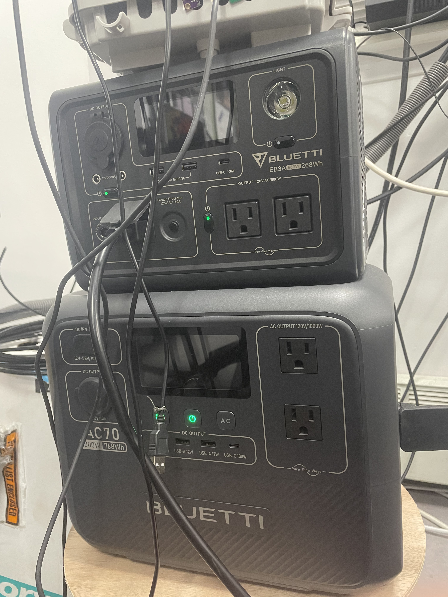
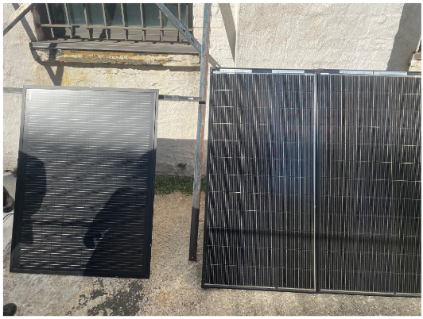
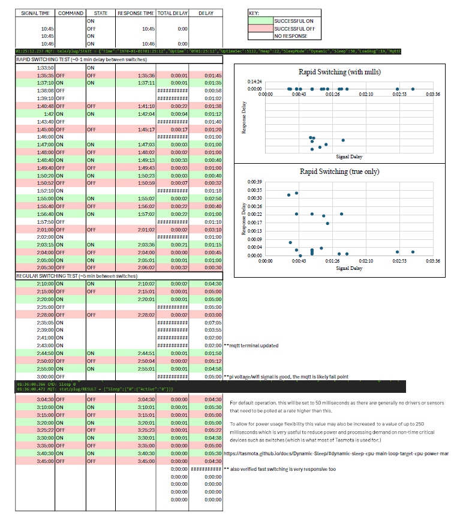
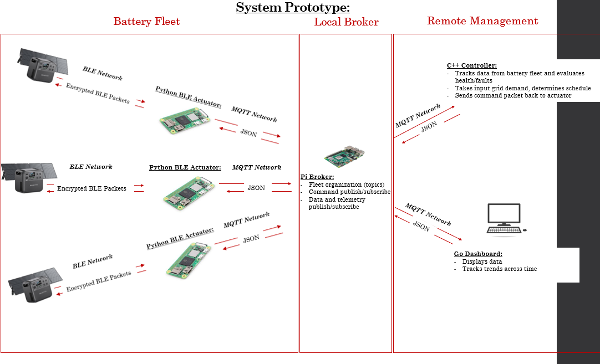

## Internship: Battery Fleet Controller <kbd>Jan 2026-July 2026</kbd>
`Embedded Systems` `MQTT` `Fleet Controls` `C++` 

*Collaborated with a mechanical/electrical team at Loisaida Ecolibrium to prototype a distributed battery control system intended to act as a Con-Ed non-wired solution and reduce peak electrical demands. Developed the C++ supervisory control architecture and MQTT communications for coordinating Bluetti battery systems.*

  <a href="https://docs.google.com/document/d/1v4bWwjNDgyZtrkNRwcYOvaFO80NGoXLbTvaOOI4C70U/edit?usp=sharing">Research Documentation</a>
  &nbsp; | &nbsp;
  <a href="docs/src">Controller Source Code</a>
  &nbsp; | &nbsp;
  <a href="https://github.com/briconnors/Raspberry-Pi">Controller Documentation</a>
  &nbsp; | &nbsp;
  <a href="docs/Bri_Battery_Documentation.pptx">Progress Powerpoint</a>

## Overview
To reduce demand on the NYC electrical grid during peak periods, we developed the communication and control architecture for coordinating a fleet of Bluetti battery systems. Batteries were scheduled to charge during lower-demand periods and supply load during grid demand peaks, reducing the total energy drawn from the utility during the daily two peak events without interrupting operation of the connected appliances.

 

  
   
  <em>Figure 1: EB3A and AC70 Bluetti batteries and panels used for prototyping (in addition to AC200, Elite 30V2, and AC300).</em>

 

___
## My Contributions
My work focused on designing the remote supervisory controller layer, while my other team members developed the local Python/BLE actuator responsible for direct communication with each battery of the fleet.

I developed the controller to monitor the network of batteries, evaluate health, report faults, and synchronize scheduling with the grid demand across the fleet. I also established an independent EB3A system at Cooper Union. My group members developed the local BLE Python actuator to decrypt the messages sent from each battery to the app according to Bluetti source code and extract the battery state from the decrypted payload.

### Relay MQTT Communications Testing
During early development I began by establishing a Raspberry Pi-4b as a local WiFi host and broker with the script as a client. The communication and switching response of a Sonoff S31 smart plug client was used as a prototype actuator to switch on and off wall power via a relay. To characterize the network response time, I recorded command and acknowledgment timing across repeated rapid-switching tests, highlighting unsuccessful responses, to evaluate communication latency and reliability before integrating the MQTT control architecture. 
 

   
  <em>Figure 2: Initial system prototyping using SonoffS31 relay to control a desktop lamp.</em>

 
The results led me to investigate the dynamic sleep setting, which was noted in documentation with a default setting of 50 ms. Although it explicitly states generally no drivers or sensors require higher polling rate, for consistient immediate response I disabled this setting forcing the ESP8266 inside the plug to remain engaged constantly and maintain the MQTT connection.

### Supervisory Controller Development
I structured the C++ controller script around the MQTT communication layer, receiving battery telemetry through standardized JSON payloads and storing the data for health and state evaluation. The controller evaluates SOC, voltage, current, local load, and the validity of telemetry. Then, the controller determines charge or discharge availability and generates a command. Commands are published to the broker and requested by the ESP8266 client, with returned device states used to verify successful execution as acknowledgments.
 

   
  <em>Figure 3: Battery fleet communication prototype diagram.</em>

 

### Outcomes
I developed an independent embedded system consisting of a Raspberry-Pi and ESP8266 switch for a low wattage EB3A battery, Python and C++ script communication through JSON packets and MQTT ran through the Pi broker, and supervisory controller organization and logic. 

The architecture was designed for expansion from an individual battery to multiple units, allowing future scheduling logic to characterize available fleet capacity and coordinate battery response to grid demand with the eventual goal of machine learning informed scheduling commands.
